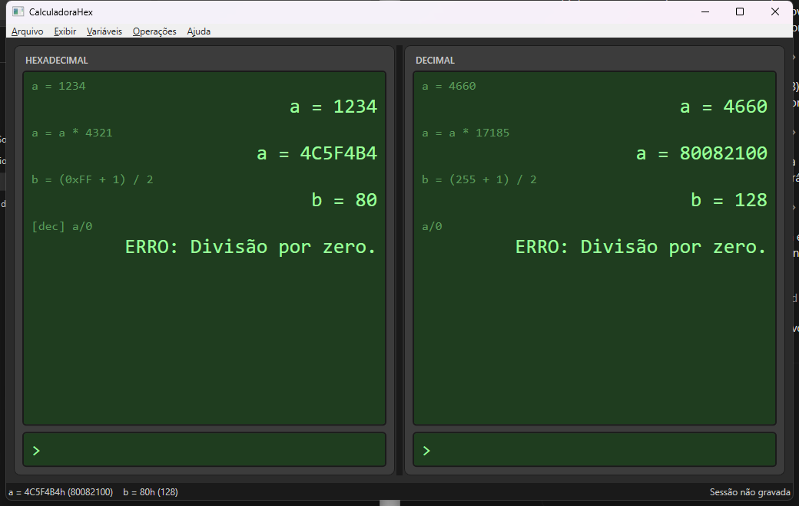

# CalculadoraHex

Calculadora desktop para Windows com dois painéis sincronizados, **Hexadecimal** à esquerda e **Decimal** à direita. O que você digita em um lado aparece traduzido no outro, variáveis valem nos dois, e tudo é gravado automaticamente.



## Uso rápido

Digite uma expressão na linha `>` de qualquer painel e pressione Enter. Os dígitos são lidos na base do painel onde você está.

| Você digita (painel hexa) | Painel hexa mostra | Painel decimal mostra |
|---|---|---|
| `a=1234` | `a = 1234` | `a = 4660` |
| `a=a*4321` | `a = 4C5F4B4` | `a = 80082100` |
| `(FF+1)/2` | `(0xFF + 1) / 2 = 80` | `(255 + 1) / 2 = 128` |

- Operadores: `+ - * /` com precedência usual, parênteses e `-` unário. Divisão inteira. Inteiros de precisão arbitrária (sem overflow).
- Variáveis: `nome = expressão`. Nomes começam por letra ou `_` e não diferenciam maiúsculas.
- No painel hexa, `a`, `b`, `cafe` são dígitos **e** nomes possíveis. Regra: se a variável existe, é variável; senão, é número. O display sublinha o token quando a regra foi aplicada. Para forçar: `0xA` / `1Fh` é sempre número, `$a` é sempre variável.
- Ctrl+1 e Ctrl+2 ocultam ou exibem cada painel; ao voltar, o histórico completo está lá.
- Comentários: uma linha que começa por `#` não é calculada. O texto entra literalmente, com o `#`, nos dois painéis (ex.: `#soma de valores`). É gravado na sessão, exportado e pode ser apagado como qualquer linha.
- Menu **Editar**: Ctrl+D apaga a última linha do histórico e recalcula as variáveis; Ctrl+T insere uma linha tracejada separadora nos dois painéis (também gravada e exportada).
- Funções: `sqrt(x)` (raiz quadrada inteira), `root(x, n)` (raiz n-ésima inteira, n de 1 a 10000) e `pow(x, n)` (potência). Tudo em inteiros, sem ponto flutuante; a raiz é arredondada para baixo. Os argumentos seguem a base do painel, como qualquer número.
- Menu **Especiais > Raiz inteira de uma variável** (Ctrl+R): acha o menor inteiro `x` que, multiplicado por si próprio `n` vezes, não passa do valor de uma variável escolhida. `n` é a quantidade de fatores, sempre em decimal (`n = 3` é `x·x·x`). Sem variável definida, pede que uma seja atribuída. Resolvida a conta, as linhas são **digitadas sozinhas na linha de entrada do painel ativo, uma por vez**, como se você fizesse a entrada dos dados, e cada uma mostra o seu resultado antes da próxima. O bloco abre com uma linha tracejada (não repetida se a última linha do histórico já for uma) e cria três **variáveis novas**, derivadas do nome escolhido: `v1_raiz` (a raiz), `v1_result` (a raiz multiplicada por si própria `n` vezes) e `v1_dif` (o que sobra de `v1`; zero se a conta é exata). Se algum dos três nomes já existir, o conjunto ganha um número no fim (`v1_raiz2`, `v1_result2`, `v1_dif2`) e nada é sobrescrito. Cada linha é uma entrada comum do histórico, apagável com Ctrl+D uma por vez. Com `n = 2`, para `v1 = 288261332929378871`:

  ```text
  ----------------------------------------------
  #calcula raiz
  v1_raiz = sqrt(v1)
                                       536899741
  #calcula o resultado
  v1_result = v1_raiz * v1_raiz
                          288261331885867081
  #calcula a diferença
  v1_dif = v1 - v1_result
                                  1043511790
  ```
  Com `n` diferente de 2 a raiz é `v1_raiz = root(v1, n)`. Os valores que já estão em variáveis aparecem pelo nome, não pelo número. O resultado é escrito como `v1_raiz * v1_raiz * v1_raiz` até 6 fatores; acima disso, como `pow(v1_raiz, n)`.
- Menu **Variáveis**: Ctrl+P imprime todas as variáveis no display, uma por linha e em ordem alfabética, entre linhas separadoras (sem repetir a anterior se já houver uma). Essas linhas guardam o valor daquele momento e são gravadas na sessão.
- F1 abre a referência de sintaxe e atalhos.

## Sessões

Cada operação é gravada em `%LOCALAPPDATA%\CalculadoraHex\sessoes\<data_hora>.json`. Ao abrir a app, a última sessão volta com histórico e variáveis. O menu **Arquivo** permite iniciar outra sessão, abrir uma antiga, salvar com outro nome e exportar o histórico em texto com as duas bases lado a lado.

Para rodar sem tocar nas sessões e preferências do uso normal, defina a variável de ambiente `CALCULADORAHEX_DATA` com o caminho de uma pasta; a app passa a gravar ali.

### Importar histórico

**Arquivo > Importar histórico** (Ctrl+I) acrescenta operações à sessão atual, sem apagar nada. Aceita:

- uma sessão gravada (`.json`), cujas linhas são reavaliadas na ordem e na base originais;
- o texto gerado por **Exportar histórico** (`.txt`): cada linha traz `[hex]` ou `[dec]` e, depois de `;`, uma anotação com a expressão e o resultado nas duas bases. Importa de volta sem perguntar a base. Linhas que deram erro saem só como anotação e não são reproduzidas;
- um script de texto (`.txt`) com uma expressão por linha. Prefixos `[hex]`, `[dec]`, `hex:` ou `dec:` fixam a base da linha; sem prefixo vale a base escolhida no diálogo. Linhas iniciadas por `#` viram comentários no histórico; as iniciadas por `;` ou `//` são ignoradas, e o que vem depois de `;` no fim de uma linha é só anotação; uma linha só de traços (`---`) vira separador; `[var] nome = valor` recria uma variável impressa.

```text
# script.txt
a = 1234
[dec] b = a * 2
hex: c = b + FF
```

## Compilar e executar

Requer o [.NET 10 SDK](https://dotnet.microsoft.com/download).

```bash
dotnet build
```

```bash
dotnet run --project src/CalculadoraHex.App
```

```bash
dotnet test
```

## Gerar o executável único

```bash
.\publicar.ps1
```

Gera `publish\CalculadoraHex.exe` autocontido (não precisa do .NET instalado). Com `-FrameworkDependent` o arquivo fica pequeno, mas exige o .NET 10 Desktop Runtime na máquina.

## Estrutura

```
src/CalculadoraHex.Core/   núcleo sem UI: parser, avaliador, variáveis, formatação, persistência
src/CalculadoraHex.App/    WPF (MVVM): janela, painéis, tema verde, diálogos, auto-save
tests/                     xUnit para o Core
PLANO.md                   projeto, decisões e fases de desenvolvimento
```

## Licença

MIT.
